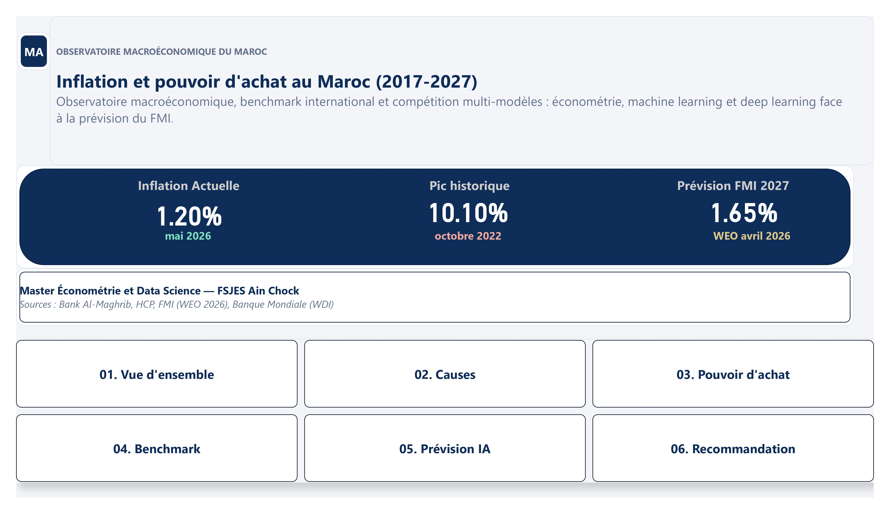
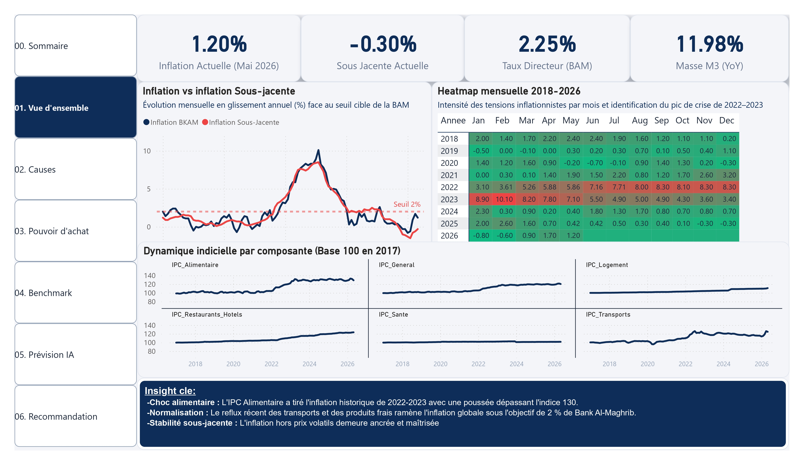
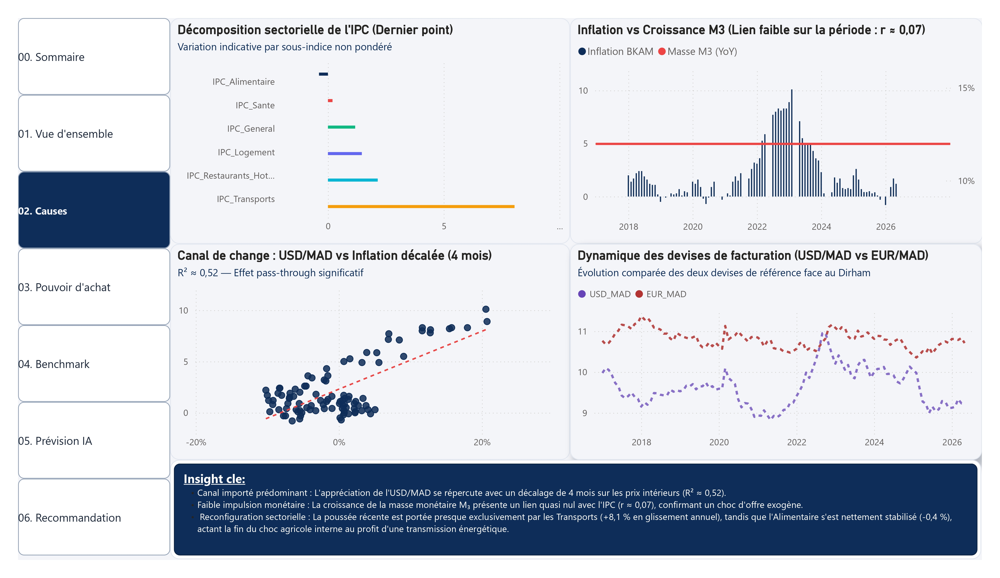
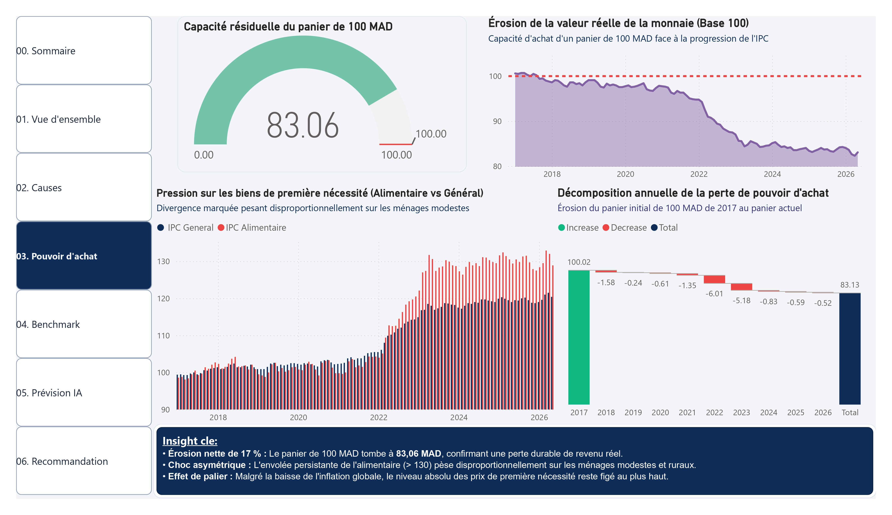
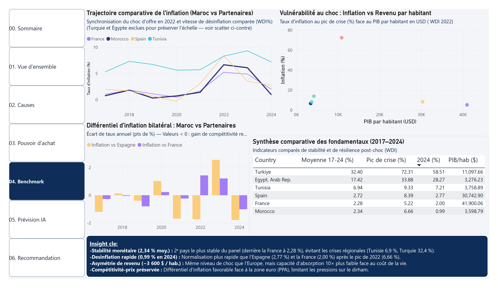
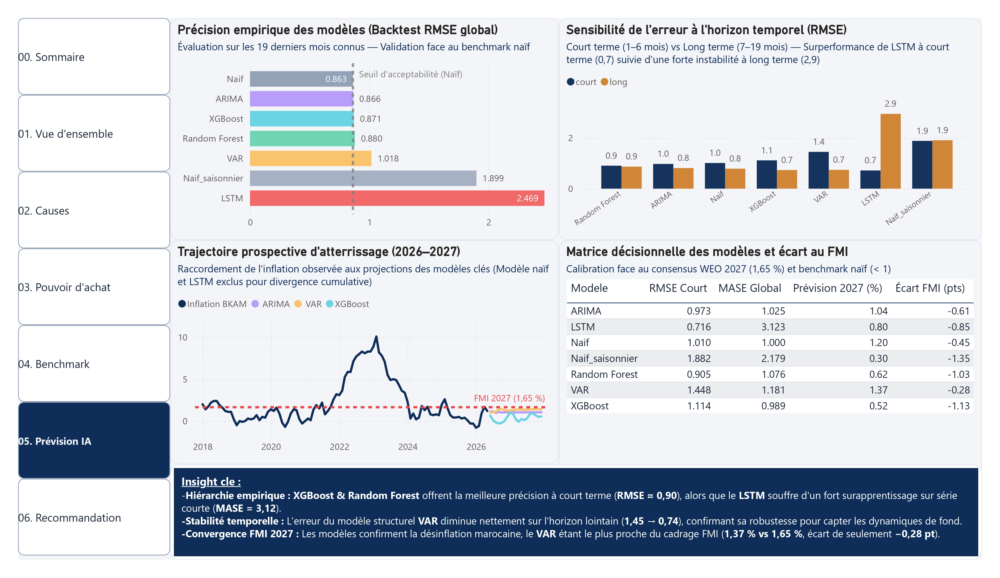
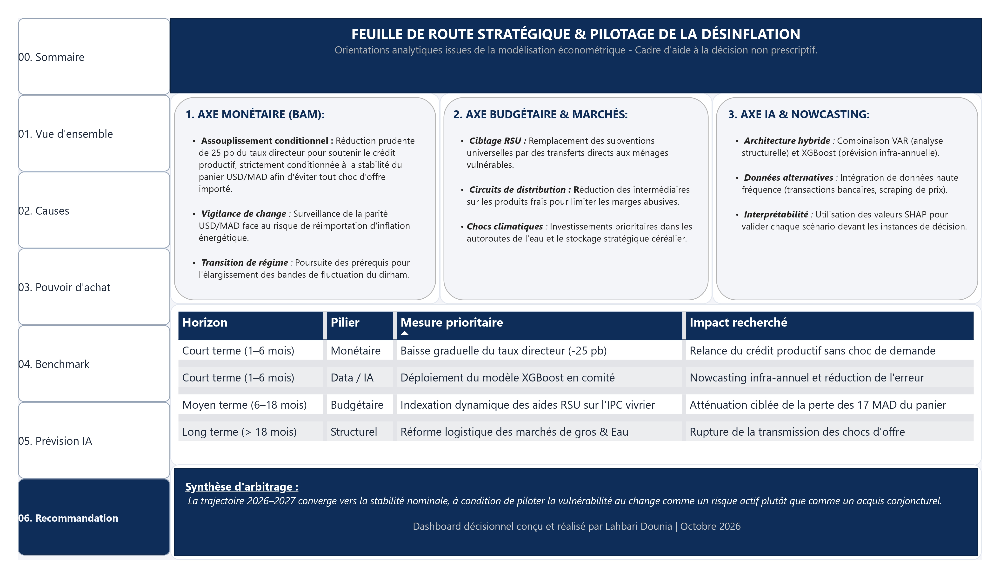

# Inflation et pouvoir d'achat au Maroc (2017-2027)
### Observatoire macroéconomique, benchmark international et compétition multi-modèles (économétrie, machine learning, deep learning) face à la prévision du FMI

> Projet individuel — Master Économétrie & Data Science, FSJES Ain Chock
> Dashboard Power BI (7 pages) + pipeline de modélisation Python (7 modèles de prévision)

---

## Aperçu du dashboard

| Sommaire | Vue d'ensemble |
|---|---|
|  |  |

| Causes de l'inflation | Pouvoir d'achat |
|---|---|
|  |  |

| Benchmark international | Prévision IA |
|---|---|
|  |  |

| Recommandations | |
|---|---|
|  | |

---

## Contexte et objectif

Après l'épisode inflationniste majeur de 2022-2023 (pic à 10,1 % en glissement annuel), ce projet répond à trois questions :

1. **Diagnostic** — l'inflation marocaine récente est-elle d'origine monétaire, importée, ou sectorielle ?
2. **Positionnement** — comment le Maroc se situe-t-il face à ses pairs régionaux et européens en matière de stabilité des prix ?
3. **Prévision** — un modèle de machine learning ou de deep learning peut-il surpasser une prévision naïve, et comment ces modèles se comparent-ils aux projections officielles du FMI ?

---

## Sources de données et traçabilité

Le détail complet de la chaîne de traitement (quelle donnée vient d'où, comment elle est transformée) est documenté dans **[`docs/DATA_LINEAGE.md`](docs/DATA_LINEAGE.md)**. En résumé :

| Catégorie | Dossier | Contenu |
|---|---|---|
| **Brute** | `data/raw/` | Données WDI (Banque Mondiale) et WEO (FMI), export direct des portails officiels |
| **Nettoyée** | `data/processed/` | `data_clean.csv` — fusion HCP + Bank Al-Maghrib + Investing.com, utilisée par le dashboard |
| **Générée** | `data/model_outputs/` | Sorties du pipeline de modélisation (backtest, prévisions, comparaison FMI), produites en exécutant `src/prediction_inflation_maroc.py` |

| Source officielle | Organisme |
|---|---|
| Indice des prix à la consommation (IPC) | Haut-Commissariat au Plan (HCP) |
| Inflation, taux directeur, M3 | Bank Al-Maghrib (BAM) |
| Taux de change USD/MAD, EUR/MAD | Investing.com |
| Prévision d'inflation 2027 (1,647 %) | FMI — World Economic Outlook, avril 2026 |
| Comparaison internationale | Banque Mondiale — World Development Indicators |

Toutes les données proviennent de sources publiques officielles, fournies ici à des fins éducatives et d'analyse. Se référer aux conditions d'utilisation de chaque organisme pour toute réutilisation en dehors de ce cadre.

---

## Méthodologie

### Modélisation (7 modèles)
- **Économétrie** : ARIMA, VAR (avec test de stationnarité ADF)
- **Machine learning** : Random Forest, XGBoost
- **Deep learning** : LSTM (PyTorch)
- **Benchmarks** : Naïf simple (inflation t-1), Naïf saisonnier (inflation t-12)

### Évaluation
- Backtest séparé **court terme (1-6 mois)** et **long terme (7-19 mois)**
- Métriques : RMSE, MAE, MAPE, et **MASE** (Mean Absolute Scaled Error — ajoutée car le MAPE devient instable sur les mois à inflation quasi nulle)
- Validation croisée 2026 : reconstruction de l'année complète comparée à la valeur réelle publiée
- Comparaison à la prévision FMI 2027 selon deux méthodes convergentes

### Limite méthodologique assumée
Les variables exogènes (taux directeur, M3, taux de change) sont gelées à leur dernier niveau connu pour l'horizon de prévision. Il s'agit d'un **scénario « sans choc »**, pas d'une prévision macroéconomique complète intégrant une réaction de politique monétaire ou des chocs externes.

---

## Résultats clés (vérifiés et reproduits)

### Performance des modèles (RMSE / MASE globaux, 19 mois de backtest)

| Modèle | RMSE global | MASE global | Verdict |
|---|---|---|---|
| Naïf (référence) | 0.863 | 1.000 | — |
| ARIMA | 0.866 | 1.025 | ≈ naïf |
| XGBoost | 0.871 | 0.989 | ✅ bat le naïf |
| Random Forest | 0.880 | 1.076 | légèrement battu |
| VAR | 1.018 | 1.181 | battu globalement |
| Naïf saisonnier | 1.899 | 2.179 | ❌ à écarter |
| LSTM | 2.469 | 3.123 | ❌ instable |

### Le cas LSTM — la divergence la plus marquante
| Horizon | RMSE LSTM |
|---|---|
| Court terme (1-6 mois) | **0.716** — le meilleur de tous les modèles |
| Long terme (7-19 mois) | **2.944** — de très loin le pire |

### Seuls VAR et XGBoost battent le naïf en long terme
| Modèle | MASE long terme |
|---|---|
| XGBoost | 0.888 |
| VAR | 0.917 |
| Naïf (référence) | 1.000 |

### Comparaison à la prévision FMI 2027 (1,647 %)
| Modèle | Prévision 2027 | Écart vs FMI |
|---|---|---|
| **VAR** | **1,37 %** | **-0,28 pt (le plus proche)** |
| ARIMA | 1,04 % | -0,61 pt |
| Random Forest | 0,62 % | -1,03 pt |
| XGBoost | 0,52 % | -1,13 pt |

**Tous les modèles sous-estiment l'inflation 2027 par rapport au FMI** — biais systématique confirmé également sur la validation croisée 2026.

### Diagnostic des causes
- **Canal de change importé significatif** : corrélation de 0,72 entre la croissance annuelle du taux USD/MAD et l'inflation 4 mois plus tard (R² ≈ 0,52).
- **Lien quasi nul avec la masse monétaire M3** à court terme (r ≈ 0,07 en glissement annuel contemporain).
- **Diffusion sectorielle évolutive** : le choc de 2022-2023 était porté par l'alimentaire ; au dernier point observé, la dynamique est portée presque exclusivement par les transports (+8,1 % sur un an), l'alimentaire s'étant stabilisé (-0,4 %).

### Positionnement international
Le Maroc se classe **2ᵉ pays le plus stable sur l'inflation** (2,34 % de moyenne 2017-2025) parmi 6 pays (Maroc, Tunisie, Turquie, Espagne, France, Égypte) — juste derrière la France (2,28 %), loin devant la Turquie (32,4 %) et l'Égypte (17,4 %). Cette stabilité coexiste avec un PIB par habitant parmi les plus faibles du panel.

---

## Structure du dashboard Power BI (7 pages)

1. **Sommaire** — portail de navigation, sources, chiffres clés
2. **Vue d'ensemble** — KPIs, heatmap calendaire, tendances sectorielles
3. **Causes** — décomposition sectorielle, canal de change, lien M3
4. **Pouvoir d'achat** — érosion de la valeur réelle, pression sur les biens essentiels
5. **Benchmark international** — trajectoire comparée, positionnement richesse/stabilité
6. **Prévision IA** — tournoi des 7 modèles, backtest, écarts FMI
7. **Recommandations** — synthèse stratégique par horizon et pilier

---

## Stack technique

- **Python** : pandas, numpy, statsmodels (ARIMA, VAR), scikit-learn (Random Forest), xgboost, PyTorch (LSTM), matplotlib
- **Power BI Desktop** : modèle en étoile, mesures DAX, visuels natifs et custom (Radar Chart)
- **Power Query (M)** : nettoyage, dépivotage, colonnes calculées

---

## Structure du dépôt

```
├── data/
│   ├── raw/                              # Données sources officielles (WDI, WEO FMI)
│   │   ├── WDI_Comparaison_Indicators.csv
│   │   └── Prediction_WEO_FMI.csv
│   ├── processed/                        # Donnée nettoyée utilisée par le dashboard
│   │   └── data_clean.csv
│   └── model_outputs/                    # Généré en exécutant src/prediction_inflation_maroc.py
│       ├── resultats_backtest_court_vs_long.csv
│       ├── previsions_futures_tous_modeles.csv
│       ├── prevision_court_terme_6mois.csv
│       ├── prevision_longue_2027.csv
│       ├── comparaison_FMI_2027.csv
│       └── figures/
│           ├── graphique_court_terme_6mois.png
│           ├── graphique_long_terme_2027.png
│           └── graphique_previsions_inflation.png
├── src/
│   └── prediction_inflation_maroc.py
├── dashboard/
│   └── Dashboard_Inflation_Maroc.pbix
├── docs/
│   ├── DATA_LINEAGE.md                   # Traçabilité détaillée des 3 catégories de données
│   └── screenshots/                      # Captures des 7 pages du dashboard
├── requirements.txt
├── .gitignore
└── README.md
```

---

## Reproduire l'analyse

```bash
git clone https://github.com/<ton-utilisateur>/inflation-maroc-dashboard.git
cd inflation-maroc-dashboard
pip install -r requirements.txt
python src/prediction_inflation_maroc.py
```

Le script retrouve automatiquement `data/processed/data_clean.csv` et `data/raw/Prediction_WEO_FMI.csv` à partir de l'emplacement du dépôt (chemins calculés dynamiquement, pas de chemin en dur) — il fonctionne quel que soit le dossier depuis lequel la commande est lancée. Il régénère tous les fichiers de `data/model_outputs/`, y compris `figures/`.

**Reproductibilité vérifiée** : exécuté depuis la racine du dépôt dans un environnement vierge, ce script produit des résultats strictement identiques à ceux fournis dans `data/model_outputs/` (vérifié y compris sur l'écart VAR vs FMI : -0,28 pt, reproduit à l'identique).

Le fichier `dashboard/Dashboard_Inflation_Maroc.pbix` s'ouvre directement avec Power BI Desktop (gratuit).

---

## Limites et travaux futurs

### Limites actuelles
- Les recommandations formulées dans le dashboard (page 6) sont **à visée analytique, issues de la modélisation — non prescriptives**. Elles n'engagent ni Bank Al-Maghrib ni aucune institution.
- Le scénario de prévision est un scénario **« sans choc »** (variables exogènes gelées) ; il ne remplace pas une prévision macroéconomique structurelle complète.
- L'échantillon de backtest (19 mois) reste limité ; les MASE rapportés doivent être interprétés avec cette réserve de taille d'échantillon.
- **Échantillon réduit pour le LSTM** : le modèle de deep learning est entraîné sur environ 100 observations mensuelles seulement. Un réseau récurrent de ce type nécessite typiquement des échantillons nettement plus larges pour stabiliser son apprentissage — ceci explique vraisemblablement une bonne partie de l'instabilité observée en long terme (MASE = 3,12), à distinguer d'une insuffisance de la méthode elle-même.

### Pistes d'ouverture
- **BVAR (VAR bayésien)** : le VAR classique est déjà le modèle le plus proche de la prévision FMI ; une version bayésienne permettrait d'intégrer des *a priori* économiques (ex. Minnesota prior) et de mieux gérer l'incertitude sur un échantillon court.
- **Modèles à composantes inobservables** (unobserved components models) : pour séparer explicitement tendance, cycle et saisonnalité de l'inflation, utile pour distinguer un choc transitoire d'un changement de régime durable.
- **Élargissement de l'échantillon** : au fur et à mesure que de nouvelles observations mensuelles seront publiées, revalider en particulier la stabilité du LSTM sur un historique plus long.

---

## Auteur

**Lahbari Dounia** — Master Économétrie & Data Science, FSJES Ain Chock
[LinkedIn](https://www.linkedin.com/in/dounia-lahbari-870896310) · [Email](mailto:dounialahbari@gmail.com) · [GitHub](https://github.com/dounialahbari-ui)

---

## Licence

Code sous licence MIT (voir `LICENSE`). Les données sources restent soumises aux conditions d'utilisation de leurs organismes respectifs (HCP, Bank Al-Maghrib, FMI, Banque Mondiale).
